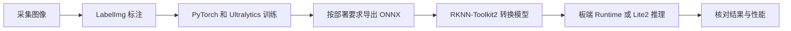

# 视觉部署笔记：从训练环境到 RKNN 推理

根据 [deeplearn.txt 原始笔记](reference/deeplearn.txt) 整理，覆盖 Miniconda、PyTorch、LabelImg、Ultralytics，以及 Rockchip RKNN 部署的环境和依赖关系。

原文件记录了训练环境安装命令和 RKNPU 路径提示，共 9 行；没有记录开发板型号、工具链版本或完整的模型转换命令。本文保留原始内容，并补充操作顺序和兼容性解释。部署命令中的 RK3588、YOLOv8 和模型路径是示例，应按实际硬件与对应版本调整；本仓库未宣称已经完成板端推理验证。

## 1. 先看整体流程



| 阶段 | 主要环境 | 主要产物 |
| --- | --- | --- |
| 标注 | 图形桌面、LabelImg | 图像、类别与标注文件 |
| 训练 | 训练主机、PyTorch、Ultralytics | 训练权重，例如 `best.pt` |
| 转换 | 与 SDK 匹配的主机系统、Python、RKNN-Toolkit2 | `.rknn` 模型 |
| 板端推理 | 目标 SoC、系统驱动、用户态 Runtime、可选 Lite2 | 检测框、类别、置信度 |

训练 GPU 的 CUDA 环境与 Rockchip NPU 的驱动不是一套依赖。转换环境的 Python 版本也不必与训练环境一致。

## 2. 原始笔记逐项说明

| 原笔记内容 | 含义 | 整理后的操作原则 |
| --- | --- | --- |
| 下载 `minconda` | 安装 Miniconda | 选择匹配操作系统和 CPU 架构的安装包 |
| `conda create ... python=3.9 ... pytorch-cuda ...` | 建立训练环境并安装 PyTorch/CUDA 依赖 | 检查 Python、PyTorch、驱动和当前包源的兼容性 |
| `pip install labelimg ...` | 安装标注工具 | 在激活的环境中安装，核对 GUI 与标注格式 |
| 克隆 `ultralytics` | 使用 YOLO 训练与推理代码 | 固定版本，保存训练配置和类别顺序 |
| `rknpu`、`/usr/lib`、`/usr/bin`、`sudo cp` | 提示板端库与可执行程序可能的部署位置 | 依据对应 SDK/BSP 的安装说明确认具体文件与路径 |
| `model-zoo cp38依赖` | 提示 Model Zoo 的 Python 3.8 相关依赖 | 检查 wheel 的 Python ABI、系统和 CPU 架构 |

完整原文按字节保存在 `reference/deeplearn.txt`，便于对照。

## 3. 准备训练环境

### 3.1 安装 Miniconda 并创建环境

从 [Miniconda 官方安装说明](https://www.anaconda.com/docs/getting-started/miniconda/install) 获取匹配系统的安装器。安装后，在初始化过 Conda 的终端中执行：

```bash
conda --version
conda create -n deeplearning python=3.9
conda activate deeplearning
python --version
python -m pip --version
```

`python=3.9` 延续原笔记。实际选择的 PyTorch、Ultralytics 版本若不支持它，应选择兼容组合或另建支持的 Python 环境，不要默认所有最新版本都可装入该环境。

### 3.2 安装并检查 PyTorch

原笔记的一次性安装命令是：

```bash
conda create -n deeplearning python=3.9 pytorch torchvision torchaudio pytorch-cuda -c pytorch -c nvidia
```

这条命令是原始记录，和 3.1 的拆分安装方式二选一；已经创建同名环境时不用再执行。它没有固定版本，能否解析出兼容组合取决于包源和版本可用性。

新环境的 PyTorch 安装方式应按 [PyTorch 官方安装选择器](https://pytorch.org/get-started/locally/) 和实际驱动选择，CPU 环境不需要 CUDA 组件。安装后检查：

```python
import torch

print("PyTorch:", torch.__version__)
print("PyTorch build CUDA:", torch.version.cuda)
print("CUDA available:", torch.cuda.is_available())
if torch.cuda.is_available():
    print("GPU:", torch.cuda.get_device_name(0))
```

`CUDA available=False` 表示当前 PyTorch 没有可用 CUDA 设备；CPU 训练仍可能可用。`nvidia-smi` 可辅助检查 NVIDIA 驱动，但不能代替上述 PyTorch 检查。

## 4. 标注数据并准备 Ultralytics

### 4.1 安装 LabelImg

原笔记使用清华 PyPI 镜像，下面显式使用当前环境的 Python：

```bash
python -m pip install labelimg -i https://pypi.tuna.tsinghua.edu.cn/simple
labelImg
```

LabelImg 需要图形桌面及兼容的 GUI 依赖。若训练框架使用 YOLO 格式，应选择相应输出格式，统一类别顺序；Pascal VOC 的 XML 标注不能直接当作 YOLO 的 TXT 标注使用。

### 4.2 获取源码并记录版本

```bash
git clone https://github.com/ultralytics/ultralytics.git
cd ultralytics
python -m pip install -e .
git rev-parse HEAD
```

部署前选定与所用 RKNN 示例相匹配的模型和导出版本。上面的克隆命令获取当时的默认分支，不构成固定版本；实际项目应记录提交号或选用验证过的 tag。

训练示例，需先准备自己的 `data.yaml` 和图像标注：

```bash
yolo detect train model=yolov8n.pt data=data.yaml epochs=100 imgsz=640
```

`yolov8n.pt` 仅是示例模型。训练结果路径可能随输出配置或已有实验目录变化，应记录实际 `best.pt`、类别名称和类别顺序。

## 5. 从训练权重进入部署流程

先在训练端用固定测试图像检查 `.pt` 模型，确认标签和框正常，再进入导出及转换。

通用 ONNX 导出示例：

```bash
yolo export model=runs/detect/train/weights/best.pt format=onnx imgsz=640 dynamic=False
```

这只是 Ultralytics 的通用导出入口。**Model Zoo 示例可能要求专门修改的模型输出和导出流程。** 例如 Rockchip 的 YOLOv8 示例说明其优化模型输出与原始模型不同，不能把任意导出的 ONNX 直接配上该示例后处理就认定兼容。

接下来按以下顺序推进：

1. 确认开发板 SoC、系统、驱动及 Runtime 版本。
2. 按所选 Model Zoo 示例的要求准备 ONNX，而不是只看文件后缀。
3. 在独立转换环境安装匹配的 Toolkit2 和依赖。
4. 先转换并检查非量化结果，再按需要使用代表性图像做 INT8 校准。
5. 部署板端 Runtime/Lite2，核对预处理、输出结构、类别顺序和后处理。

具体的 `cp38`、库路径、转换与运行说明见 [RKNN 部署说明](docs/rknn-deployment.md)。

## 6. 保存可复现信息

在项目实际使用的每个环境中记录：

```bash
python --version
python -m pip freeze > environment-pip.txt
uname -m
```

训练环境还可导出：

```bash
conda env export --no-builds > environment-conda.yml
```

导出的环境文件发布前应检查是否包含私有包源或本机绝对路径。训练环境、转换环境、板端环境分别命名记录，并附上模型来源、输入尺寸、量化模式、类别顺序和测试图像结果。

目前原始笔记缺少以下信息，后续复现时需要补充：

| 信息 | 当前记录 |
| --- | --- |
| 训练主机系统、Python 与 PyTorch 完整版本 | 只记录了 Python 3.9 和包名 |
| 开发板 SoC、系统镜像与驱动版本 | 未记录 |
| Toolkit2、Runtime、Lite2 和 Model Zoo 版本 | 未记录 |
| `cp38` 对应 wheel 的完整文件名和架构 | 未记录 |
| 复制到系统目录的具体文件、来源与目标路径 | 未记录 |
| 实际模型、类别配置与部署验证结果 | 未记录 |

## 7. 仓库结构与资料

```text
vision-deployment-notes/
├── README.md                  # 从原始笔记整理的训练与部署流程
├── docs/
│   └── rknn-deployment.md      # cp38、Runtime 与 Model Zoo 部署说明
└── reference/
    └── deeplearn.txt           # 原始笔记
```

- [PyTorch 安装说明](https://pytorch.org/get-started/locally/)
- [LabelImg](https://github.com/HumanSignal/labelImg)
- [Ultralytics 快速开始](https://docs.ultralytics.com/quickstart/)
- [Ultralytics 模型导出](https://docs.ultralytics.com/modes/export/)
- [Rockchip RKNN Model Zoo](https://github.com/airockchip/rknn_model_zoo)
- [RKNN-Toolkit2](https://github.com/airockchip/rknn-toolkit2)

本次整理核对了原始笔记、本机配套项目说明，以及 Rockchip 上游 YOLOv8 示例的转换/运行接口。文档命令是操作说明，未执行环境重装、系统库替换或板端模型推理。
